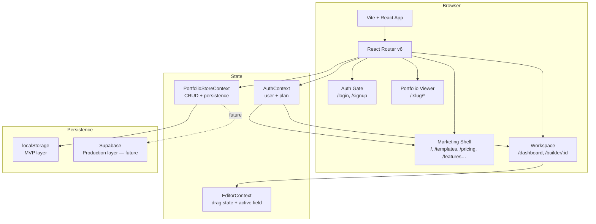
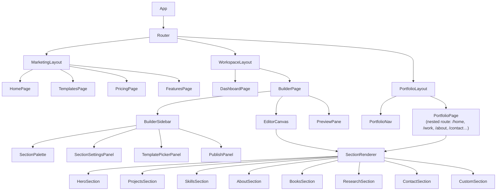
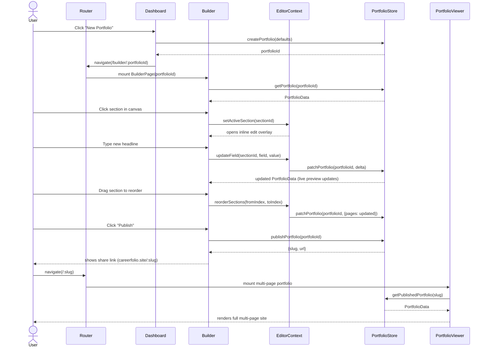
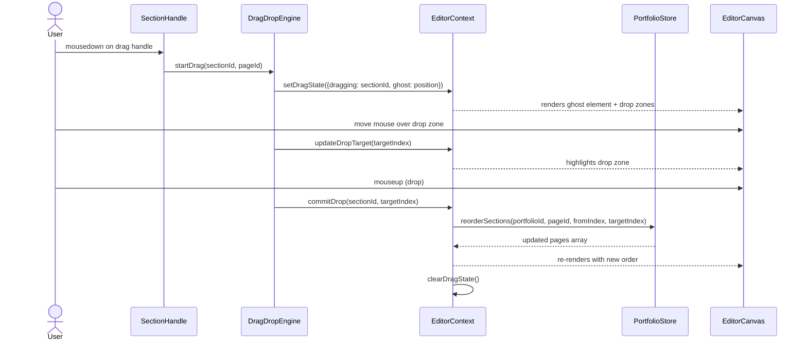
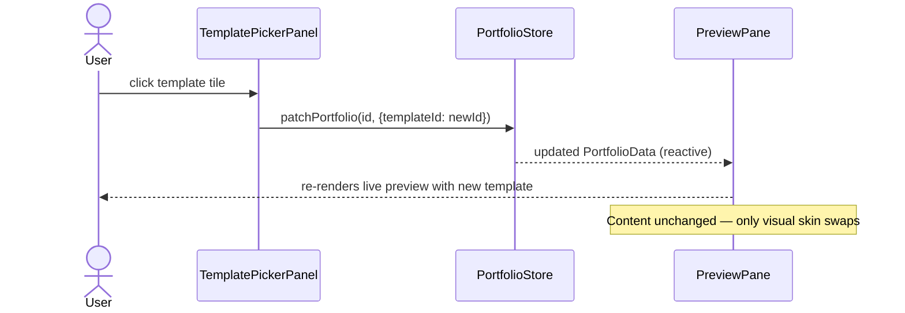

# Design Document: Careerfolio V2 Rebuild

## Overview

Careerfolio V2 is a full rebuild of the existing single-file MVP into a production-quality portfolio-builder SaaS. The rebuild introduces React Router-based multi-page portfolios, a visual drag-and-drop + click-to-edit builder, editorial-quality multi-page templates, and a scalable component architecture — all while preserving the existing localStorage persistence layer and the established design language (DM Sans, Fraunces, lime accent, dark editorial templates).

The architecture separates concerns cleanly into four layers: the **marketing shell** (public-facing routes), the **authenticated workspace** (dashboard + builder), the **visual editor engine** (drag-and-drop + inline editing), and the **published portfolio renderer** (multi-page output with its own nested Router). Every template is a self-contained multi-page site rendered from a shared `PortfolioData` schema.

---

## Architecture

### High-Level System Layers



### Component Tree (Collapsed)



---

## Sequence Diagrams

### User Creates and Publishes a Portfolio



### Drag-and-Drop Section Reorder



### Template Switch



---

## Components and Interfaces

### Component: `BuilderPage`

**Purpose**: Top-level orchestrator for the visual editor. Manages the three-panel layout (sidebar / canvas / live preview) and wires EditorContext to PortfolioStore.

**Interface**:
```typescript
interface BuilderPageProps {
  portfolioId: string   // from useParams()
}
```

**Responsibilities**:
- Fetch `PortfolioData` from `PortfolioStore` on mount
- Provide `EditorContext` to all children
- Render `BuilderSidebar` | `EditorCanvas` | `PreviewPane` in a CSS grid
- Handle keyboard shortcut: `Cmd/Ctrl+Z` → `EditorContext.undo()`
- Auto-save on every `PortfolioData` change (debounced 600 ms)

---

### Component: `EditorCanvas`

**Purpose**: The editable centre panel. Renders sections in their current page order, overlays click-to-edit targets on hover, and hosts drag handles for reordering.

**Interface**:
```typescript
interface EditorCanvasProps {
  portfolio: PortfolioData
  activePage: string       // e.g. 'home' | 'work' | 'about'
  onSectionClick: (sectionId: string) => void
  onDragStart: (sectionId: string) => void
  onDrop: (targetIndex: number) => void
}
```

**Responsibilities**:
- Map `portfolio.pages[activePage].sections` → `<SectionRenderer>` with edit overlays
- Show `+` add-section zone between every section gap
- Highlight hovered section with a `[Edit]` button affordance
- Render drag ghost during active drag

---

### Component: `SectionRenderer`

**Purpose**: Universal section dispatcher — given a `SectionData` object, renders the correct section component for the active template.

**Interface**:
```typescript
interface SectionRendererProps {
  section: SectionData
  templateId: string
  mode: 'editor' | 'preview' | 'published'
  isActive: boolean
  onFieldChange?: (field: string, value: unknown) => void
}
```

**Responsibilities**:
- Switch on `section.type` → render `HeroSection`, `ProjectsSection`, etc.
- In `editor` mode: wrap with edit overlay, expose inline `<ContentEditable>` on active fields
- In `preview` mode: render as static HTML (no overlays)
- In `published` mode: identical to preview but with actual links enabled

---

### Component: `SectionPalette`

**Purpose**: Sidebar panel listing all available section types. Drag from palette to canvas to add a new section to the current page.

**Interface**:
```typescript
interface SectionPaletteProps {
  currentPageSectionTypes: string[]
  onAddSection: (type: SectionType, insertAtIndex?: number) => void
}
```

**Responsibilities**:
- Show all 8 section types with icons and labels
- Grey out / badge "already added" when a singleton section (e.g. Hero) is present
- Allow drag-to-canvas gesture to insert at a specific position

---

### Component: `PreviewPane`

**Purpose**: Live scaled-down read-only preview of the full portfolio in the right panel of the builder.

**Interface**:
```typescript
interface PreviewPaneProps {
  portfolio: PortfolioData
  activePage: string
  scale?: number   // defaults to auto-fit
}
```

**Responsibilities**:
- Render the full `PortfolioLayout` at reduced scale using CSS `transform: scale()`
- Show a page-tab strip (Home / Work / About / Contact…) to preview other pages
- Provide "Open full preview" button that opens `/:slug/preview` in a new tab

---

### Component: `PortfolioLayout`

**Purpose**: The published multi-page portfolio shell. Contains the nav bar and a nested `<Routes>` for the portfolio's own pages.

**Interface**:
```typescript
interface PortfolioLayoutProps {
  portfolio: PortfolioData
  mode: 'preview' | 'published'
}
```

**Responsibilities**:
- Render `<PortfolioNav>` with the pages defined in `portfolio.pages`
- Set CSS custom properties from `template.colors` on a root wrapper element
- Provide a nested `<Routes>` so `/ankur-rana/work`, `/ankur-rana/about`, etc. all resolve correctly
- Apply `template.fonts` via a `<style>` tag injected into the layout

---

## Data Models

### `PortfolioData` — Master Document

```typescript
interface PortfolioData {
  id: string                     // e.g. 'p-1750000000000'
  ownerId: string                // user id
  slug: string                   // URL-safe, unique
  templateId: string             // e.g. 'noir', 'terminal'
  name: string                   // portfolio owner's display name
  role: string                   // headline / tagline
  published: boolean
  customDomain?: string

  pages: Record<PageSlug, PageData>
  // e.g. { home: PageData, work: PageData, about: PageData, contact: PageData }

  pageOrder: PageSlug[]          // controls nav order
  meta: PortfolioMeta

  createdAt: string              // ISO 8601
  updatedAt: string
}

type PageSlug = string           // 'home' | 'work' | 'about' | 'contact' | 'books' | 'research' | string
```

**Validation Rules**:
- `slug` must match `/^[a-z0-9]+(?:-[a-z0-9]+)*$/`
- `pageOrder` must contain at least one entry
- `pages` must have an entry for every slug in `pageOrder`
- `templateId` must be a known template id

---

### `PageData`

```typescript
interface PageData {
  slug: PageSlug
  title: string               // e.g. 'Work', shown in nav
  sections: SectionData[]     // ordered list of sections on this page
}
```

---

### `SectionData` — Union Discriminated by `type`

```typescript
type SectionData =
  | HeroSection
  | ProjectsSection
  | SkillsSection
  | AboutSection
  | BooksSection
  | ResearchSection
  | StatsSection
  | ContactSection
  | CustomSection

interface BaseSection {
  id: string           // nanoid, stable across edits
  type: SectionType
  hidden?: boolean
}

type SectionType =
  | 'hero'
  | 'projects'
  | 'skills'
  | 'about'
  | 'books'
  | 'research'
  | 'stats'
  | 'contact'
  | 'custom'
```

---

### `HeroSection`

```typescript
interface HeroSection extends BaseSection {
  type: 'hero'
  headline: string
  subheadline: string
  avatarUrl?: string
  location?: string
  tags: string[]               // e.g. ['Developer', 'Author', 'Researcher']
  ctaLabel: string             // e.g. 'View my work'
  ctaTarget: PageSlug          // which page to link to
  showStats: boolean
  stats: Array<{ value: string; label: string }>
}
```

---

### `ProjectsSection`

```typescript
interface ProjectsSection extends BaseSection {
  type: 'projects'
  heading: string
  projects: ProjectItem[]
}

interface ProjectItem {
  id: string
  title: string
  description: string
  tag: string                  // tech stack label e.g. 'Rust · WASM'
  imageUrl?: string
  liveDemoUrl?: string
  githubUrl?: string
  featured: boolean
  caseStudyContent?: string    // rich text / markdown for detailed view
}
```

---

### `BooksSection`

```typescript
interface BooksSection extends BaseSection {
  type: 'books'
  heading: string
  books: BookItem[]
}

interface BookItem {
  id: string
  title: string
  subtitle?: string
  coverUrl?: string
  description: string
  purchaseUrl?: string
  year?: string
}
```

---

### `ResearchSection`

```typescript
interface ResearchSection extends BaseSection {
  type: 'research'
  heading: string
  papers: ResearchPaper[]
}

interface ResearchPaper {
  id: string
  title: string
  abstract: string
  publishedAt: string
  doiUrl?: string
  pdfUrl?: string
  tags: string[]
}
```

---

### `TemplateDefinition`

```typescript
interface TemplateDefinition {
  id: string
  name: string
  type: PortfolioType            // 'Developer' | 'Designer' | 'Student' | ...
  tone: string
  tier: 'free' | 'pro'
  colors: TemplateColors
  fonts: TemplateFonts
  defaultPageOrder: PageSlug[]   // pages this template ships with
  defaultSections: Record<PageSlug, SectionType[]>
}

interface TemplateColors {
  bg: string
  ink: string
  card: string
  accent: string
  accentContrast: string         // text color on accent background
  border: string
}

interface TemplateFonts {
  heading: string                // CSS font-family value
  body: string
  mono: string
}
```

---

### `PortfolioMeta`

```typescript
interface PortfolioMeta {
  email: string
  location?: string
  linkedin?: string
  github?: string
  twitter?: string
  website?: string
  seoTitle?: string
  seoDescription?: string
}
```

---

## Algorithmic Pseudocode

### Section Reorder Algorithm

```pascal
ALGORITHM reorderSections(pageData, fromIndex, toIndex)
INPUT: pageData of type PageData, fromIndex of type integer, toIndex of type integer
OUTPUT: updatedPageData of type PageData

PRECONDITIONS:
  - fromIndex >= 0 AND fromIndex < length(pageData.sections)
  - toIndex >= 0 AND toIndex < length(pageData.sections)
  - fromIndex != toIndex

BEGIN
  sections ← copy(pageData.sections)
  
  // Remove the section from its current position
  movedSection ← sections[fromIndex]
  sections.removeAt(fromIndex)
  
  // Adjust target index if we removed an element before it
  IF toIndex > fromIndex THEN
    adjustedTarget ← toIndex - 1
  ELSE
    adjustedTarget ← toIndex
  END IF
  
  // Insert at adjusted position
  sections.insertAt(adjustedTarget, movedSection)
  
  ASSERT length(sections) = length(pageData.sections)
  ASSERT sections[adjustedTarget] = movedSection
  
  RETURN { ...pageData, sections: sections }
END
```

**Preconditions**: Both indices are in bounds; indices differ.
**Postconditions**: Sections array has same length; moved section appears at target index.
**Loop Invariants**: N/A (no loops).

---

### Click-to-Edit Field Resolution Algorithm

```pascal
ALGORITHM resolveEditableFields(sectionType, templateId)
INPUT: sectionType of type SectionType, templateId of type string
OUTPUT: fields of type EditableField[]

BEGIN
  baseFields ← SECTION_FIELD_REGISTRY[sectionType]
  
  IF baseFields IS NULL THEN
    RETURN []
  END IF
  
  overrides ← TEMPLATE_FIELD_OVERRIDES[templateId][sectionType]
  
  IF overrides IS NULL THEN
    RETURN baseFields
  END IF
  
  // Merge template overrides into base fields
  result ← []
  FOR each field IN baseFields DO
    override ← overrides.find(f => f.key = field.key)
    IF override IS NOT NULL THEN
      result.append(merge(field, override))
    ELSE
      result.append(field)
    END IF
  END FOR
  
  RETURN result
END
```

**Preconditions**: `SECTION_FIELD_REGISTRY` is populated for all known section types.
**Postconditions**: Returns a non-null array; base fields are always represented.

---

### Portfolio Publish Validation Algorithm

```pascal
ALGORITHM validatePortfolioForPublish(portfolio)
INPUT: portfolio of type PortfolioData
OUTPUT: result of type ValidationResult

BEGIN
  errors ← []
  
  // Name is required
  IF isEmpty(portfolio.name) THEN
    errors.append({ field: 'name', message: 'Portfolio name is required' })
  END IF
  
  // Slug format
  IF NOT matchesPattern(portfolio.slug, /^[a-z0-9]+(?:-[a-z0-9]+)*$/) THEN
    errors.append({ field: 'slug', message: 'Slug must be lowercase with hyphens only' })
  END IF
  
  // At least one page
  IF length(portfolio.pageOrder) = 0 THEN
    errors.append({ field: 'pages', message: 'Portfolio must have at least one page' })
  END IF
  
  // Every page in pageOrder has a matching PageData entry
  FOR each slug IN portfolio.pageOrder DO
    IF portfolio.pages[slug] IS NULL THEN
      errors.append({ field: 'pages', message: `Page "${slug}" is listed in order but has no content` })
    END IF
  END FOR
  
  // Each page has at least one section
  FOR each slug IN portfolio.pageOrder DO
    page ← portfolio.pages[slug]
    IF page IS NOT NULL AND length(page.sections) = 0 THEN
      errors.append({ field: `pages.${slug}`, message: `Page "${page.title}" has no sections` })
    END IF
  END FOR
  
  IF length(errors) > 0 THEN
    RETURN { valid: false, errors: errors }
  ELSE
    RETURN { valid: true, errors: [] }
  END IF
END
```

**Preconditions**: `portfolio` is a non-null PortfolioData object.
**Postconditions**: Returns `{ valid: boolean, errors: ValidationError[] }`. If `valid: true`, `errors` is empty.

---

### Template Color Application Algorithm

```pascal
ALGORITHM applyTemplateCSSVars(templateId, containerElement)
INPUT: templateId of type string, containerElement of type HTMLElement
OUTPUT: void (side effect: sets CSS custom properties)

BEGIN
  template ← TEMPLATE_REGISTRY.get(templateId)
  
  IF template IS NULL THEN
    template ← TEMPLATE_REGISTRY.get('canvas')  // safe fallback
  END IF
  
  colors ← template.colors
  fonts ← template.fonts
  
  containerElement.style.setProperty('--p-bg', colors.bg)
  containerElement.style.setProperty('--p-ink', colors.ink)
  containerElement.style.setProperty('--p-card', colors.card)
  containerElement.style.setProperty('--p-accent', colors.accent)
  containerElement.style.setProperty('--p-accent-contrast', colors.accentContrast)
  containerElement.style.setProperty('--p-border', colors.border)
  containerElement.style.setProperty('--font-heading', fonts.heading)
  containerElement.style.setProperty('--font-body', fonts.body)
  containerElement.style.setProperty('--font-mono', fonts.mono)
END
```

**Preconditions**: `TEMPLATE_REGISTRY` is initialized before any call.
**Postconditions**: `containerElement` has all 9 CSS variables set; no template id is left without styles.

---

## Key Functions with Formal Specifications

### `createPortfolio(ownerId, templateId?)`

```typescript
function createPortfolio(ownerId: string, templateId?: string): PortfolioData
```

**Preconditions**:
- `ownerId` is a non-empty string
- `templateId`, if supplied, is a known template id

**Postconditions**:
- Returns a complete `PortfolioData` with `id`, `ownerId`, `published: false`
- `pages` are seeded from `template.defaultSections`
- `pageOrder` matches `template.defaultPageOrder`
- `slug` is initially empty (user must set before publishing)

---

### `patchPortfolio(portfolioId, delta)`

```typescript
function patchPortfolio(portfolioId: string, delta: Partial<PortfolioData>): PortfolioData
```

**Preconditions**:
- `portfolioId` exists in the store
- `delta` is a plain object (no prototype pollution)

**Postconditions**:
- Returns merged `PortfolioData` with all `delta` fields applied
- `updatedAt` is set to `new Date().toISOString()`
- Deep-merges `pages` (does not wholesale replace)
- Triggers localStorage persistence (debounced)

---

### `reorderSections(portfolioId, pageSlug, fromIndex, toIndex)`

```typescript
function reorderSections(portfolioId: string, pageSlug: string, fromIndex: number, toIndex: number): PortfolioData
```

**Preconditions**:
- Portfolio and page exist
- Both indices are valid and differ

**Postconditions**:
- Returns updated `PortfolioData`; section count unchanged; moved section at `toIndex`

**Loop Invariants**: N/A

---

### `publishPortfolio(portfolioId)`

```typescript
function publishPortfolio(portfolioId: string): { slug: string; url: string }
```

**Preconditions**:
- `validatePortfolioForPublish(portfolio)` returns `{ valid: true }`
- `portfolio.slug` is unique among published portfolios

**Postconditions**:
- `portfolio.published` is `true`
- Returns `{ slug, url }` where `url` is the canonical public URL
- Throws `PublishValidationError` if validation fails

---

## Example Usage

### Bootstrapping the editor for an existing portfolio

```typescript
// In BuilderPage.tsx
const { portfolioId } = useParams<{ portfolioId: string }>()
const { getPortfolio, patchPortfolio } = usePortfolioStore()
const portfolio = getPortfolio(portfolioId)

// Debounced auto-save
const debouncedSave = useMemo(
  () => debounce((delta: Partial<PortfolioData>) => patchPortfolio(portfolioId, delta), 600),
  [portfolioId]
)
```

### Inline text editing on a Hero section

```typescript
// In HeroSection.tsx (editor mode)
<ContentEditable
  tagName="h1"
  html={section.headline}
  onChange={(evt) => onFieldChange('headline', evt.target.value)}
  className="hero-headline"
  disabled={mode !== 'editor'}
/>
```

### Adding a section from the palette

```typescript
// In SectionPalette.tsx
const handleAddSection = (type: SectionType) => {
  const newSection = createDefaultSection(type)          // factory with sensible defaults
  const updated = [...currentPage.sections, newSection]
  patchPortfolio(portfolioId, {
    pages: {
      ...portfolio.pages,
      [activePage]: { ...currentPage, sections: updated }
    }
  })
}
```

### Published portfolio nested routing

```typescript
// In PortfolioLayout.tsx
<Routes>
  {portfolio.pageOrder.map((slug) => (
    <Route
      key={slug}
      path={slug === 'home' ? '/' : `/${slug}`}
      element={<PortfolioPage portfolio={portfolio} pageSlug={slug} />}
    />
  ))}
  <Route path="*" element={<Navigate to="/" replace />} />
</Routes>
```

---

## Correctness Properties

*A property is a characteristic or behavior that should hold true across all valid executions of a system — essentially, a formal statement about what the system should do. Properties serve as the bridge between human-readable specifications and machine-verifiable correctness guarantees.*

### Property 1: Section order stability

*For any* `PageData` and any valid pair of distinct indices `fromIndex` and `toIndex`, the result of `reorderSections(pageData, fromIndex, toIndex)` has the same length as the original sections array, contains all original section IDs, and has the moved section's ID at `toIndex`.

**Validates: Requirements 4.2**

---

### Property 2: Section reorder identity

*For any* `PageData` and any valid index `i`, calling `reorderSections(pageData, i, i)` returns a sections array equal to the original (identity / idempotence).

**Validates: Requirements 4.5**

---

### Property 3: Template isolation

*For any* `PortfolioData` with any number of sections, switching `templateId` (via `patchPortfolio`) never mutates any section `id`, `type`, or content field. All section data is identical before and after a template switch.

**Validates: Requirements 7.3**

---

### Property 4: Publish precondition enforcement

*For any* `PortfolioData`, `publishPortfolio()` sets `published: true` if and only if `validatePortfolioForPublish()` returns `{ valid: true }`. When validation returns `{ valid: false }`, the function throws a `PublishValidationError` and `portfolio.published` remains `false`.

**Validates: Requirements 9.1, 9.2**

---

### Property 5: Page consistency invariant

*For any* sequence of add-page and remove-page operations on a `PortfolioData`, `portfolio.pageOrder` always contains exactly the set of keys present in `portfolio.pages` — no orphaned pages and no missing entries — after every operation.

**Validates: Requirements 3.5, 8.3, 8.4**

---

### Property 6: Inline edit non-destructiveness

*For any* `ContentEditable` onChange event — including one that delivers an empty string — the resulting stored `SectionData` field value is a string (never `null` or `undefined`), so no downstream renderer can crash on a missing field.

**Validates: Requirements 5.4**

---

### Property 7: CSS variable completeness

*For any* template ID (including unknown/invalid ones), `applyTemplateCSSVars(templateId, element)` always sets all nine CSS custom properties (`--p-bg`, `--p-ink`, `--p-card`, `--p-accent`, `--p-accent-contrast`, `--p-border`, `--font-heading`, `--font-body`, `--font-mono`) on the container element, falling back to the `canvas` template when the ID is unrecognised.

**Validates: Requirements 7.4, 7.5**

---

### Property 8: PortfolioData serialisation round-trip

*For any* valid `PortfolioData` object, serialising to JSON then deserialising back to a `PortfolioData` produces an object equal to the original — all pages, sections, metadata, and IDs are preserved.

**Validates: Requirements 3.1, 16.2**

---

### Property 9: createDefaultSection completeness

*For any* valid `SectionType` value, `createDefaultSection(type)` returns a `SectionData` with a unique `id` (generated by nanoid), the correct `type`, and no `undefined` values on any required field — making it immediately serialisable.

**Validates: Requirements 6.3, 16.3**

---

### Property 10: DOMPurify sanitisation removes injected content

*For any* HTML string passed to the DOMPurify sanitiser, the output never contains `<script>` elements or event-handler attributes (`onclick`, `onerror`, etc.), regardless of the original string's structure or encoding.

**Validates: Requirements 5.3, 15.1**

---

### Property 11: Slug sanitiser output format

*For any* printable string input, `slugify(input)` always returns a string matching `/^[a-z0-9-]*$/` — no uppercase letters, no special characters, no whitespace.

**Validates: Requirements 9.7, 15.2**

---

### Property 12: Empty-delta patch is identity

*For any* `PortfolioData`, calling `patchPortfolio(portfolioId, {})` (empty delta) produces a portfolio where all content fields are unchanged from the original.

**Validates: Requirements 3.6**

---

### Property 13: resolveEditableFields never returns null

*For any* `(sectionType, templateId)` pair — including unknown or mismatched combinations — `resolveEditableFields(sectionType, templateId)` returns a non-null array. It may be empty, but it is never `null` or `undefined`.

**Validates: Requirements 5.6**

---

### Property 14: validatePortfolioForPublish is complete

*For any* `PortfolioData` that violates at least one publish precondition (empty name, invalid slug pattern, empty pageOrder, orphaned page slug, or page with no sections), `validatePortfolioForPublish()` returns `{ valid: false }` with a non-empty `errors` array containing an entry for each violation.

**Validates: Requirements 9.3**

---

### Property 15: TemplateDefinition completeness

*For any* template ID in the template registry, the corresponding `TemplateDefinition` has all required `colors` fields (`bg`, `ink`, `card`, `accent`, `accentContrast`, `border`) and all required `fonts` fields (`heading`, `body`, `mono`) with no undefined values.

**Validates: Requirements 7.2**

---

## Error Handling

### Scenario 1: Unknown Template ID

**Condition**: A saved portfolio references a `templateId` that no longer exists (e.g., a template was removed).
**Response**: Fall back to `'canvas'` (always free, always available). Log a warning.
**Recovery**: User can switch template freely from the builder. Their content is unaffected.

### Scenario 2: Corrupt localStorage Data

**Condition**: `JSON.parse` throws on the stored portfolio blob.
**Response**: `readLocal()` catches the error and returns the provided fallback value. A toast notification informs the user that their data could not be loaded.
**Recovery**: User is offered a "Reset this portfolio" option that creates a fresh default document.

### Scenario 3: Slug Collision on Publish

**Condition**: User attempts to publish with a slug already taken by another portfolio (same user or another).
**Response**: `publishPortfolio()` throws `SlugConflictError`. The builder highlights the slug field with an error message: "This URL is already taken — try a different one."
**Recovery**: User edits the slug in the Publish panel and retries.

### Scenario 4: Drag-and-Drop to Invalid Drop Zone

**Condition**: User drops a section outside any valid drop zone (e.g., on the sidebar).
**Response**: `DragDropEngine` detects no valid `targetIndex`, calls `clearDragState()` without committing. Section returns to original position with a CSS revert animation.
**Recovery**: Automatic — no state change, user can retry.

### Scenario 5: Missing Page in Nested Router

**Condition**: User visits `/:slug/research` but the portfolio has no `research` page.
**Response**: The nested `<Route path="*">` catches the miss and redirects to `/:slug/` (the home page).
**Recovery**: Transparent to user; no error is shown.

---

## Testing Strategy

### Unit Testing Approach

Test all pure functions in `portfolioStore.ts` and `editorHelpers.ts` in isolation:
- `reorderSections()` — verify length invariant, position correctness, and edge cases (first↔last swap)
- `validatePortfolioForPublish()` — verify all validation rules with both valid and invalid inputs
- `createDefaultSection(type)` — verify every section type produces a valid `SectionData` with no undefined required fields
- `applyTemplateCSSVars()` — mock `HTMLElement.style.setProperty`, assert all 9 properties called

### Property-Based Testing Approach

**Property Test Library**: fast-check

Key properties to test:
- **Reorder idempotency**: `reorderSections(data, i, i)` is identity for all valid `i`
- **Reorder reversibility**: Applying the inverse reorder restores the original order
- **Patch non-destructiveness**: `patchPortfolio(id, {})` (empty delta) does not change any content field
- **Slug sanitizer**: `slugify(s)` always returns a string matching `/^[a-z0-9-]*$/` for any printable string input

### Integration Testing Approach

- **Builder → Store → Preview round-trip**: Edit a field in `EditorCanvas`, assert the same value appears in `PreviewPane` within 100 ms
- **Publish flow**: Create portfolio → set required fields → publish → assert `/:slug` route renders the correct name and sections
- **Template switch**: Switch template → assert `PortfolioLayout` root element has the new template's `--p-accent` CSS variable set

---

## Performance Considerations

- **Debounced auto-save**: All `patchPortfolio` calls from the editor are debounced at 600 ms to avoid thrashing localStorage on every keystroke.
- **Virtualised section list**: If a page has more than 20 sections (power-user edge case), the `EditorCanvas` uses a windowing approach (`react-virtual`) to keep DOM nodes bounded.
- **Lazy template imports**: Each template's section-specific style overrides are split into separate CSS modules and imported lazily when the template is first rendered.
- **PreviewPane scaling**: The preview uses `transform: scale()` + `will-change: transform` and renders in a separate stacking context to avoid layout thrashing in the main editor panel.
- **Image optimisation (future)**: Section `imageUrl` fields will go through a Cloudflare Images transform URL at publish time. In the MVP, raw URLs are stored as-is.

---

## Security Considerations

- **XSS in ContentEditable**: All `innerHTML` values from `ContentEditable` are sanitised via `DOMPurify` before being stored in `SectionData`. This prevents script injection from user-typed content.
- **Slug injection**: `slugify()` whitelists only `[a-z0-9-]` characters, preventing path traversal or URL injection.
- **No server-side plan elevation from browser**: The plan upgrade flow follows the existing pattern in `PRODUCTION.md` — the browser never writes to `subscriptions`; only the payment webhook does.
- **Custom domain validation**: Custom domain strings are validated against a strict hostname regex before storage and are never interpolated directly into `<script>` or `<link>` tags.
- **localStorage scope**: All data is scoped to the current origin. No cross-origin access vectors are introduced by the routing model.

---

## File Structure

```
src/
├── main.jsx                          # App entry — mounts Router + global providers
├── styles.css                        # Global design tokens (keep existing)
│
├── contexts/
│   ├── AuthContext.jsx               # user, plan, login(), logout(), signup()
│   ├── PortfolioStoreContext.jsx     # portfolio CRUD + localStorage persistence
│   └── EditorContext.jsx             # active section, drag state, undo stack
│
├── hooks/
│   ├── usePortfolioStore.js          # thin wrapper over PortfolioStoreContext
│   ├── useEditor.js                  # thin wrapper over EditorContext
│   ├── useAuth.js                    # thin wrapper over AuthContext
│   └── useDebounce.js
│
├── data/
│   ├── templates.js                  # TemplateDefinition[] registry
│   ├── defaultSections.js            # createDefaultSection(type) factory
│   └── samplePortfolios.js           # seed data (Ankur Rana demo)
│
├── utils/
│   ├── slugify.js
│   ├── sanitize.js                   # DOMPurify wrapper
│   ├── portfolioHelpers.js           # reorderSections, validatePortfolioForPublish
│   └── cssVars.js                    # applyTemplateCSSVars
│
├── layouts/
│   ├── MarketingLayout.jsx           # topbar + footer shell for public pages
│   ├── WorkspaceLayout.jsx           # topbar for dashboard + builder
│   └── PortfolioLayout.jsx           # portfolio nav + nested <Routes>
│
├── pages/
│   ├── marketing/
│   │   ├── HomePage.jsx
│   │   ├── TemplatesPage.jsx
│   │   ├── FeaturesPage.jsx
│   │   ├── PricingPage.jsx
│   │   ├── ResourcesPage.jsx
│   │   └── ...legal, help, contact
│   ├── workspace/
│   │   ├── DashboardPage.jsx
│   │   └── BuilderPage.jsx
│   ├── auth/
│   │   ├── LoginPage.jsx
│   │   └── SignupPage.jsx
│   └── portfolio/
│       ├── PortfolioViewerPage.jsx   # public viewer shell — resolves slug → data
│       └── PortfolioPage.jsx         # renders a single page's sections
│
├── components/
│   ├── shared/
│   │   ├── Header.jsx
│   │   ├── SiteFooter.jsx
│   │   ├── UpgradeModal.jsx
│   │   ├── Button.jsx
│   │   └── Icon.jsx
│   ├── builder/
│   │   ├── BuilderSidebar.jsx
│   │   ├── EditorCanvas.jsx
│   │   ├── PreviewPane.jsx
│   │   ├── SectionPalette.jsx
│   │   ├── SectionSettingsPanel.jsx
│   │   ├── TemplatePickerPanel.jsx
│   │   ├── PublishPanel.jsx
│   │   └── DragDropEngine.jsx
│   └── sections/
│       ├── SectionRenderer.jsx       # dispatcher
│       ├── HeroSection.jsx
│       ├── ProjectsSection.jsx
│       ├── SkillsSection.jsx
│       ├── AboutSection.jsx
│       ├── BooksSection.jsx
│       ├── ResearchSection.jsx
│       ├── StatsSection.jsx
│       ├── ContactSection.jsx
│       └── CustomSection.jsx
│
└── templates/
    ├── noir/
    │   └── noir.css                  # template-specific overrides
    ├── terminal/
    │   └── terminal.css
    └── ... (one folder per template)
```

---

## Dependencies

| Package | Purpose | Notes |
|---|---|---|
| `react-router-dom` v6 | Multi-page routing (app shell + nested portfolio routes) | Add to package.json |
| `@dnd-kit/core` + `@dnd-kit/sortable` | Accessible drag-and-drop for section reordering | Preferred over react-beautiful-dnd (maintained) |
| `react-contenteditable` | Click-to-edit inline text fields | Thin wrapper; evaluate sanitisation carefully |
| `dompurify` | Sanitise HTML from ContentEditable before storage | Security requirement |
| `nanoid` | Stable unique IDs for sections and pages | Lightweight alternative to uuid |
| `framer-motion` | Drag ghost animation, section add/remove transitions | Optional but high-quality feel |
| Existing: `react`, `react-dom`, `vite`, `@vitejs/plugin-react` | Already installed | No change needed |

No new CSS framework is introduced. The existing `styles.css` design token system is extended with per-template CSS modules.
